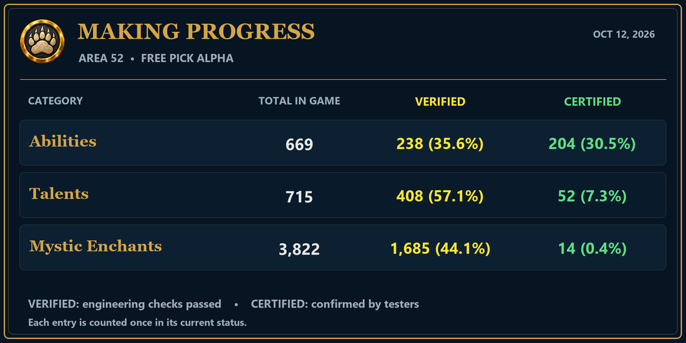

## Area 52 — Bulwark, Hotspots & Character Repairs

**Close Ascension, reopen the Bear Cave Launcher, and press Play to install the matching client update before testing.**

### Bulwark build

- Completed the 78-entry Bulwark build review: 24 additional entries are now VERIFIED, while existing CERTIFIED entries retain their status.
- Repaired linked shield effects, block procs, stance effects, mitigation, energy handling and supporting abilities. Updated tooltip status labels and the granted-ability catalog.
- Connected Portal Mastery and Runeforging to their supported trainer lessons, retaining the existing lesson requirements and ownership rules.

### Character repairs

- Fixed right-click CERTIFY eligibility for learned talents in the Advancement menu.
- All HERO characters receive Dual Wield, including existing characters on login. Starter daggers can be equipped in the offhand.
- Restored missing transformation models, including Flame Ascendance, Air Ascendance and Twisted Seal.
- Includes the Spartan Kick client repair that prevents Kick from being blocked by an incorrect client prerequisite.

### XP Hotspot map tools

- Selected hotspots now show their perimeter; whole-zone entries use a larger icon selection frame.
- Corrected map transitions and world-map hotspot positioning.
- SHIFT-click map markers or browser rows to select multiple hotspots for merging.
- GMs can teleport to a selected hotspot and permanently delete an entry after confirming.
- Browse / Active now occupies a full-width row at the bottom of the controls.

## MAKING PROGRESS

The graphic below shows the current totals. VERIFIED entries have passed engineering checks; CERTIFIED entries have been confirmed by testers.

