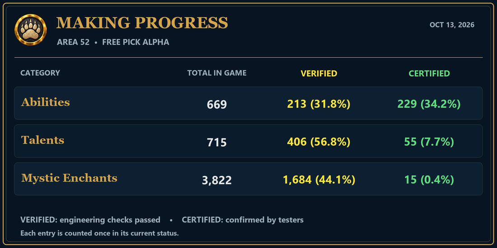

# Area 52 update — October 13, 2026

Close Ascension and reopen the Bear Cave Launcher, then press Play to install this update.

- Worldforged scrolls now have 33 mapped boss/source drops at 100%, with one copy of each matching scroll in shared loot.
- Added 22 Worldforged cache test placements. Five fragments combine into a key; opening a cache consumes one key for its bound scroll. Repeat purchases are allowed.
- Worldforged scrolls bind on pickup, including previously issued copies.
- Remorseless Attacks is VERIFIED. Its final-rank capstone refreshes an existing Slice and Dice to its five-combo-point duration.
- Removed Feed Pet from Area 52 Beast abilities and cleaned up existing learned copies. Corrected the underlying oversized-heal calculation.
- Selling a Mystic Scroll to a vendor no longer opens its equip confirmation.
- XP Hotspots now show tool feedback in a movable, scrollable window above the map. New Draft exits drawing mode and rejects stale drafts; CTRL-click creation is repaired.

## MAKING PROGRESS

VERIFIED: engineering checks passed. CERTIFIED: confirmed by testers. Each entry is counted once in its current status.

