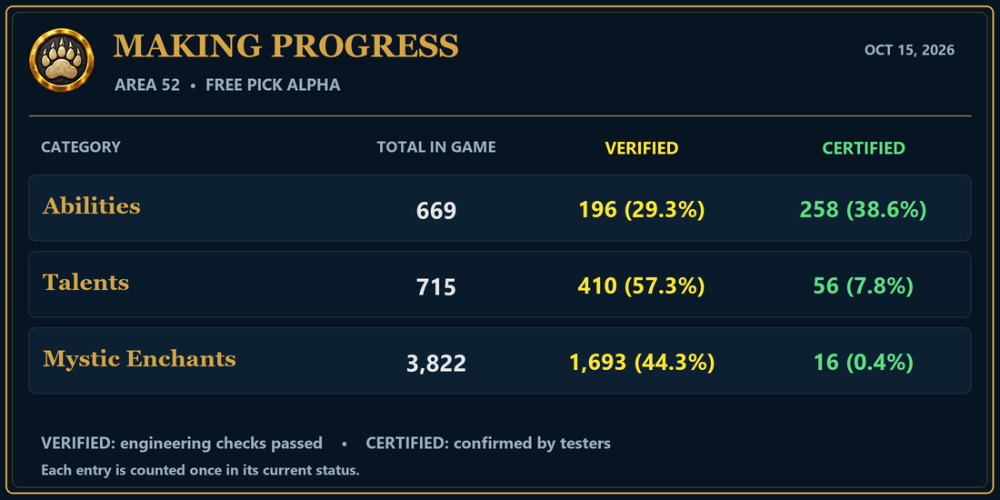

# Area 52 update — White Walker

White Walker has completed engineering Verification. Live tester Certification remains a separate step, and existing Certified entries remain Certified.

## White Walker verification

- Verified Tether Elemental and its displayed Raise Elemental, Revive Elemental, Dismiss Elemental and Elemental Lore abilities.
- Verified Eviscerate, Benediction, Frostbrand Weapon, Seal of Wisdom, Maelstrom Weapon, Cold Blood, Demonic Leap, Cut to the Chase, Roll the Bones, Molten Armor and Frozen Power.
- Verified the Athletic Icing, Frozen Power, Fighter's Sinister Strike, Absolute Zero, Tides of Battle, Freezing Blood and White Walker Mystic Enchants.
- Connected and checked the associated ranks, proc paths, damage timing, status lifecycles, granted abilities and recursive dependencies using the agreed engineering Verification requirements.
- Updated 52 displayed spell records so the verified White Walker abilities and ranks now show **VERIFIED**. This includes Tether Elemental and its four displayed companion actions. Existing **CERTIFIED** tooltip records were preserved.

Close Ascension, close and reopen the Bear Cave Launcher, then press **Play** to install the matching client update before testing.

## MAKING PROGRESS

VERIFIED means engineering checks passed. CERTIFIED means confirmed by testers. Each catalog entry is counted once in its current status.

| Category | Total in game | VERIFIED | CERTIFIED |
|---|---:|---:|---:|
| Abilities | 669 | 196 (29.3%) | 258 (38.6%) |
| Talents | 715 | 410 (57.3%) | 56 (7.8%) |
| Mystic Enchants | 3,822 | 1,693 (44.3%) | 16 (0.4%) |

